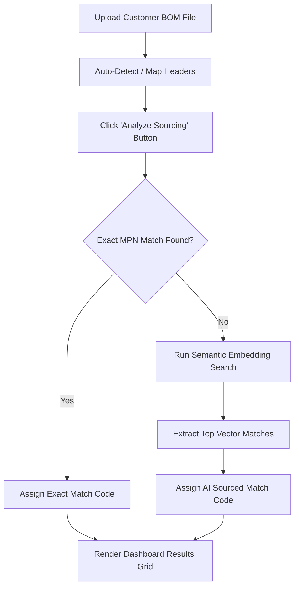

# SourceBuddy Intelligence Suite
## Detailed Enterprise User Manual & Operations Guide
*Designed for RS Components Sourcing & Procurement Excellence*

---

## 📖 1. System Overview

**SourceBuddy** is a high-performance, AI-powered procurement intelligence suite engineered to accelerate Bill of Materials (BOM) diagnostics, component sourcing, and price optimization. By combining lightning-fast semantic vector search with deterministic rule-based algorithms, SourceBuddy enables procurement teams to match incoming customer BOMs against master component catalogs in sub-second latency.

### 🏗️ Technical Architecture
* **Frontend:** Responsive, single-page Glassmorphism UI built with Vanilla JS and CSS variables.
* **Backend:** REST API powered by FastAPI (Python).
* **Semantic Vector Store:** Server-hosted Qdrant Vector Database (handles 630K+ active component indexes).
* **Relational Database:** Google Cloud MySQL Instance (centralized system management, session tokens, audit logs, and user schemas).
* **Machine Learning Pipeline:** Local CPU-optimized custom-trained technical embeddings (`sourcebuddy-electronics-bert`).

---

## 👥 2. Role-Based Access Control (RBAC)

SourceBuddy implements a strict, multi-tenant permission framework to control boundaries of operations, allowing external clients (like RS Components) to operate the application while maintaining master licensing controls on the database side.

| Operational Role | Navigation Access | Vector Build / Ingestion | Clear Vector DB | User Management (CRUD) |
| :--- | :--- | :--- | :--- | :--- |
| **System Admin** (`admin`) | Full Suite | Yes | Yes | **Yes (Full Control)** |
| **Client Admin** (`client_admin`) | Full Suite (Hidden User Tab) | Yes | Yes | **No (403 Forbidden)** |
| **Procurement Expert** (`procurement_expert`) | BOM Diagnostics & Explorer | No | No | No |
| **Viewer** (`viewer`) | Catalog Explorer Only | No | No | No |

---

### 🛡️ Detailed Role Configurations

#### A. System Admin (`admin`)
* **Purpose:** Built for SourceBuddy administrators to manage licensing, accounts, and server operations.
* **Controls:** 
  * Full access to the **User Management Console**.
  * Can Create, Read, Update, and Delete (CRUD) accounts.
  * Can configure user roles, passwords, and custom **Validity Periods** (`valid_until` UTC timestamps).
  * Can lock/unlock accounts dynamically.

#### B. Client Admin (`client_admin`)
* **Purpose:** Built for local administrators at RS Components to manage local data sets without having administrative control over global licenses.
* **Controls:**
  * Can upload master library files.
  * Can trigger Celery vector build processes and clear the database indices.
  * **Completely restricted from the User Management Console** (the UI hides the element, and backend API requests return `403 Forbidden`).

#### C. Procurement Expert (`procurement_expert`)
* **Purpose:** Sourcing engineers and procurement specialists processing bulk client BOMs.
* **Controls:**
  * Full BOM Diagnostic matching suite.
  * Catalog Explorer access.
  * Bulk export matching reports to Microsoft Excel.

#### D. Viewer (`viewer`)
* **Purpose:** Basic or guest users.
* **Controls:**
  * Read-only searching in the Catalog Explorer.
  * Restricted from performing BOM diagnostic batch file parsing.

---

## ⚙️ 3. Operations & Administrative Guide

### 🔑 3.1 Account Management (System Admin Only)
The User Management Console is accessible via the **System Admin** navigation tab in the sidebar.

#### Adding a New User:
1. Click the blue **"Add User"** button.
2. Enter the unique **Username**, **Full Name**, and **Email Address**.
3. Provide a password.
4. Set the **Access Role** (Viewer, Procurement Expert, Client Admin, or System Admin).
5. Specify the UTC **Valid Until** timestamp (format: `YYYY-MM-DD HH:MM:SS`, default: `2036-01-01 00:00:00`).
6. Toggle **Approved for Login** checkbox.
7. Click **"Save User Details"**.

#### Editing or Suspending a User:
* Click **"Edit"** next to any user.
* To suspend an account immediately, uncheck **"Approved for Login"** or set the **"Valid Until"** field to a past date.
* *Note: Usernames are immutable for database reference integrity and cannot be changed after creation.*

#### Deleting a User:
* Click **"Delete"** next to a user. The system will prompt a confirmation and automatically clear all active session tokens and log audit histories for that user account.

---

### ⚡ 3.2 Catalog Ingestion & Vector Build (Admins Only)
Ingesting a new master library file builds the Qdrant semantic indexes for searches.

1. Go to the **System Admin** panel in the sidebar.
2. Click **"Upload Source"** under **1. Data Ingestion** to select a master file (`.txt`, `.csv`, or `.xlsx` format).
3. The server validates the format and copies the library file to the server storage.
4. Under **2. Vector Build**, select your uploaded file from the dropdown list.
5. Click **"Start Build"**.
6. The system launches a background worker task. The **Indexing Status** bar dynamically transitions to **ACTIVE** and streams real-time parsing count updates (e.g. `Ingested 50,000 / 637,803 records`).

> [!WARNING]
> Rebuilding the vector index consumes high memory (utilizing CPU threads for embeddings). It is highly recommended to perform index builds during off-peak hours.

---

## 🚀 4. Sourcing & BOM Diagnostics Manual

### 🔍 4.1 Running a BOM Sourcing Run
The core procurement workflow is executed in the **BOM Diagnostics** tab.

#### Step-by-Step Walkthrough:
1. **Upload BOM:** Click **"Upload BOM File"** and upload your client's spreadsheet.
2. **Column Mapping:** The system automatically maps your file headers (detects Quantity, Description, Manufacturer, and Part Number). If the file has non-standard columns, manually adjust the drop-down mappings.
3. **Execute Search:** Click **"Analyze Sourcing"**.
4. **Interactive Dashboard:** The system returns:
   * **Direct Sourced matches:** Deterministic part matching.
   * **AI Sourced matches:** Highly-relevant semantic matches based on contextual description similarity.
   * **Unmatched items:** Parts with missing identifiers needing manual inspection.

---

### 📥 4.2 Microsoft Excel Export & Auditing
Once the analysis completes, click **"Export to Excel"** to download the audited results.

The generated `.xlsx` document features:
* **Source Tracking:** Clear separation of user inputs and matched RS components catalog details.
* **Quantities Scaled:** Quantities are automatically multiplied by project batch counts for purchase order readiness.
* **Match Quality Audit:** Each row explicitly lists the confidence match score and matching mechanism type (`Exact Match` vs `Semantic Match`).

---

## 🔧 5. Troubleshooting & FAQ

### Q1: The backend displays "Duplicate column name 'role'" or database errors on launch.
* **Resolution:** This is standard schema migration checking on start-up. The system connects to the Google Cloud MySQL instance and ensures columns are present; if already present, it logs the check and moves on. The DB remains fully initialized and ready.

### Q2: A user cannot log in, displaying "Account expired".
* **Resolution:** Ask your System Admin to check the user's `valid_until` field in the User Management Console. If the date is past the current local UTC time, edit the user and extend their validity period.

### Q3: How do we completely clear database records to start fresh?
* **Resolution:** Under the **System Admin** panel, navigate to **Dangerous Actions**, click **"Clear Vector DB"**, and type the confirmation code `DELETE_ALL`. This wipes all semantic embeddings safely.
